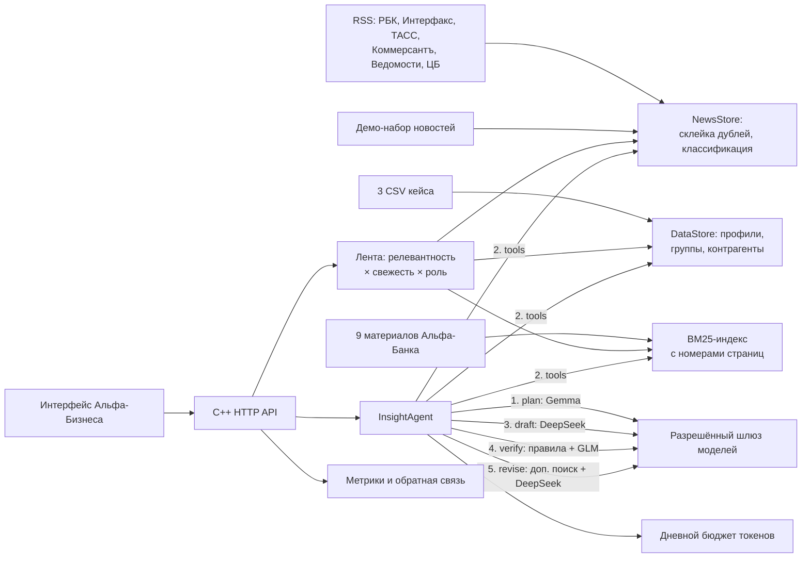

# Новости для бизнеса — AI-аналитик событий для крупных клиентов Альфа-Банка

Решение кейса «Новостная аналитика для принятия бизнес-решений» (хакатон «Альфа Будущее», 2026).

Публичная ссылка: `start-public.cmd` (туннель Cloudflare, без аккаунтов) или бесплатный сервер — Railway, Render (`render.yaml`), Hugging Face (`deploy/huggingface/`) — инструкция в [docs/DEPLOY.md](docs/DEPLOY.md).

Сервис внутри интернет-банка Альфа-Бизнес. Руководитель крупной компании (выручка от 15 млрд руб.) видит не новостную ленту, а **персональный разбор событий**: что произошло, почему это важно именно его компании, какие риски и возможности это создаёт, что можно сделать и **как это оценивает Альфа-Банк** — со ссылкой на каждый источник.

```
Главный экран Альфа-Бизнеса → «Новости для бизнеса» → выбор клиента и роли
→ персональная лента (меняется при смене клиента или роли)
→ разбор новости AI-агентом: план → инструменты → черновик → самопроверка → доработка
→ уточняющий вопрос / другой разрез / первоисточник → оценка «полезно / нет»
```

## Быстрый старт

Нужен только Docker.

```bash
cp .env.example .env          # впишите ALFA_LLM_API_KEY, выданный организаторами
docker compose up --build     # сборка, прогон юнит-тестов, запуск
```

Откройте http://127.0.0.1:8080 — главный экран интернет-банка с точкой входа в сервис.

На Windows с Docker Desktop достаточно дважды щёлкнуть `start-demo.cmd`: он соберёт и запустит сервис и откроет браузер. Остановить — `stop-demo.cmd`.

Без ключа сервис тоже работает: лента, профиль, поиск по аналитике и разбор по правилам. В каждом ответе видно, каким методом он получен (`generation.method`).

Публикация на бесплатном сервере — [docs/DEPLOY.md](docs/DEPLOY.md). Другие способы запуска: Linux без Docker — `./build.sh && ./build/alpha_backend`; Windows и Visual Studio — [docs/WINDOWS_BUILD.md](docs/WINDOWS_BUILD.md).

## Сценарий проверки (5 минут)

1. Откройте http://127.0.0.1:8080. Это главный экран интернет-банка Альфа-Бизнес: крупная красная плитка **«Новости для бизнеса»** и пункт меню с тем же названием. Справа — главное событие дня для выбранной компании и роли.
2. Нажмите плитку. Откроется **карта влияния**: слева три события, в центре компания (отрасль, регион, продукты банка), справа «темы влияния» — тема, из-за которой событие важно именно этой компании, и процент релевантности. События листаются по три («Далее»).
3. Справа карточка выбранного события: «почему вам», все признаки релевантности, связанный материал Альфа-Банка, ссылка на первоисточник.
4. Смените «Ваш взгляд» (роль) — например, на «Руководитель казначейства»: карта перестроится, валютные события поднимутся. Нажмите на компанию в правом верхнем углу и выберите другую (есть поиск и фильтр отрасли): лента изменится целиком.
5. Нажмите **«Получить разбор»**. Агент вернёт: «Что произошло» (факт), «Почему это важно вам», последствия, риски, возможности, действия (помечены «Вывод AI»), **«Позиция Альфа-Банка»** (отдельный блок, только если её подтверждает материал банка), предложение продукта банка (помечено «реклама»).
6. У каждого утверждения есть ссылки `[N1, C1, A2]`: N — новость, C — профиль компании, P — контрагенты по платежам, R — связанные новости, A — материалы Альфа-Банка с документом и страницей. Раскройте «Как агент пришёл к выводу»: шаги plan, tools, draft, verify, revise, finalize с решением на каждом шаге и временем.
7. Нажмите «Взгляд казначея», «Сценарии», «Первоисточники» или задайте свой вопрос. Оцените разбор («Да / Нет») и откройте http://127.0.0.1:8080/api/v1/metrics — метрики качества и расход токенов.
8. У валютных событий есть кнопка **«Рассчитать сценарий»**: вкладка «Сценарии» считает, как изменится рублёвая стоимость валютного платежа при другом курсе (параметры задаёт пользователь, расчёт локальный, это не прогноз).
9. Проверка на новых новостях: в рабочем режиме сервис каждые 30 минут забирает RSS шести изданий (`POST /api/v1/news/refresh` — сразу). Можно разобрать любую статью по ссылке или тексту: `POST /api/v1/insights` с `url` или `text`.

## Как это устроено



- **Профиль компании.** Отрасль по ОКВЭД, выручка и её процентиль в отрасли по выборке, регион, банковские продукты, ВЭД, группа компаний, связи через физлиц, ключевые контрагенты по платежам и их отрасли. Пропуски остаются «неизвестно», рыночная доля не выдумывается (её нет в данных).
- **Лента.** Правила без вызова модели, поэтому мгновенно и бесплатно: прямое совпадение отрасли компании с темой новости, чувствительность отрасли к типу события, кредиты или депозиты при новостях о ставке, ВЭД при новостях о валюте и санкциях, отрасли контрагентов, регион, приоритеты роли. Сравнение по началу слова, чтобы «встал» не считалось «сталью».
- **Агент.** Сам строит план (какие запросы к аналитике банка и какие инструменты нужны), вызывает инструменты, пишет черновик, проверяет его программно (у каждого утверждения есть источник, позиция банка ссылается на материал банка, цифр нет «из головы») и моделью-рецензентом. При проблемах делает дополнительный поиск и переписывает черновик. Подробно: [docs/AGENT.md](docs/AGENT.md).
- **Модели.** Только разрешённые: Gemma 4 26B — план и уточнения, DeepSeek-V4.1-Flash — разбор, GLM-5.3-Flash — проверка. Модель и шлюз проверяются по списку кейса на каждом вызове. Ключ только на сервере.
- **Экономия бюджета.** Лента без модели; разбор только по клику; кэш разборов (повторное открытие бесплатно); дневной лимит токенов `ALFA_LLM_DAILY_TOKEN_LIMIT`, после него честный режим по правилам.

## Соответствие критериям кейса

| Критерий | Где реализовано |
|---|---|
| 01 Бизнес-контекст и отбор событий | Профиль компании (`/api/v1/companies/{id}`), лента `score_relevance` с причинами |
| 02 Содержательная интерпретация | Агент учитывает отрасль, продукты, контрагентов, роль, связанные новости и аналитику банка |
| 03 Позиция Альфа-Банка отделена от AI | Блок «Позиция Альфа-Банка» только при ссылке на A-источник; выводы помечены «Вывод AI» |
| 04 Связь с первоисточниками | `evidence_ids` у каждого утверждения, `sources[]` с URL, документом и страницей |
| 05 Новые новости | RSS по расписанию, разбор по URL или тексту, классификация без заготовок |
| 06 Полный сценарий | Интерфейс `ui/`: главный экран → карта влияния → разбор → уточнение → оценка → расчёт сценария; проверяется браузерным тестом `tests/ui/ui_e2e.py` |
| 07 Масштабирование | [docs/SCALING.md](docs/SCALING.md) |
| 08 Метрики и мониторинг | `GET /api/v1/metrics`, [docs/METRICS.md](docs/METRICS.md) |
| 09 Точка входа на главном экране | Главный экран `#home`: плитка и пункт меню «Новости для бизнеса» |
| 10 Уточнение, разрез, первоисточник | `POST /api/v1/insights/{id}/questions` с `question` или `lens` |
| 11 Агентная логика | plan → tools → draft → verify → revise, [docs/AGENT.md](docs/AGENT.md) |
| 12 Трассируемость | `agent_trace[]`: шаг, статус, решение, детали, время |
| Безопасность AI-компонентов | [docs/SECURITY.md](docs/SECURITY.md) |

## API

Полный контракт — [openapi.yaml](openapi.yaml), примеры для фронтенда — [docs/FRONTEND_API.md](docs/FRONTEND_API.md).

| Маршрут | Назначение |
|---|---|
| `GET /api/v1/clients?q=&industry=&region=&limit=&offset=` | Крупные клиенты (выручка ≥ 15 млрд) |
| `GET /api/v1/clients/facets` | Отрасли и регионы для фильтров |
| `GET /api/v1/roles` | Роли пользователя |
| `GET /api/v1/companies/{id}` · `/network` | Профиль и контрагенты |
| `GET /api/v1/companies/{id}/feed?role=&limit=` | Персональная лента |
| `GET /api/v1/news` · `POST /api/v1/news/refresh` | Хранилище новостей и сбор RSS |
| `POST /api/v1/insights` | Разбор: `company_id` + `news_id` или `url` или `text`, `role` |
| `POST /api/v1/insights/{id}/questions` | Уточнение: `question` и/или `lens` |
| `POST /api/v1/feedback` | Оценка разбора |
| `GET /api/v1/metrics` | Метрики качества и бюджет |
| `GET /api/v1/analytics/search?q=` | Поиск по аналитике Альфа-Банка |
| `POST /api/v1/parse` | Извлечение текста статьи по URL |

## Конфигурация

Все параметры — переменные окружения, шаблон в [.env.example](.env.example).

| Переменная | По умолчанию | Назначение |
|---|---|---|
| `ALFA_LLM_API_KEY` | — | Ключ организаторов; только на сервере |
| `ALFA_LLM_BASE_URL` | `https://changellenge.up.railway.app/v1` | Или `https://api.alfahack-gateway26.ru/v1` для российских хостингов |
| `ALFA_LLM_MODEL` / `_FAST` / `_REVIEW` | DeepSeek / Gemma / GLM | Модели по шагам, только из списка кейса |
| `ALFA_LLM_DAILY_TOKEN_LIMIT` | `400000` | Дневной лимит токенов на весь сервис |
| `ALFA_AGENT_SELF_CHECK` | `1` | `0` отключает модель-рецензента (программная проверка остаётся) |
| `ALFA_NEWS_REFRESH_MINUTES` | `30` | Период сбора RSS, `0` — выключено |
| `ALFA_API_TOKEN` | пусто | Bearer-токен для `/api/v1/*` |
| `ALFA_STATIC_DIR` | `ui` (`/app/ui` в Docker) | Каталог собранного интерфейса |
| `ALFA_CORS_ORIGIN` | пусто | Origin фронтенда при локальной разработке |
| `ALFA_HOST`, `ALFA_PORT` | `127.0.0.1`, `8080` | Адрес сервера (`0.0.0.0` в Docker) |
| `ALFA_DATA_DIR`, `ALFA_ANALYTICS_DIR`, `ALFA_NEWS_SEED`, `ALFA_WORK_DIR` | `data/...`, `work` | Данные и состояние |

## Тесты

```bash
./build.sh                                   # сборка
./build/backend_tests                        # 25 юнит-тестов: клиенты, RSS, лента и темы влияния, новости банков-конкурентов, верификатор, бюджет, метрики
python3 -I tests/e2e_test.py                 # 14 сквозных тестов через HTTP, включая агента с локальной тестовой моделью (она ведёт себя как «думающие» модели шлюза)
node --test tests/ui/core.test.cjs           # 6 тестов логики интерфейса (калькулятор, безопасные ссылки, страницы ленты)
python3 -I tests/ui/ui_e2e.py                # 21 проверка всего сценария в браузере (нужен Playwright с Chromium)
ctest --test-dir build --output-on-failure   # юнит-тесты + индекс аналитики (64 проверки)
```

Сквозные тесты поднимают настоящий сервер и локальную OpenAI-совместимую тестовую модель (`tests/mock_llm.py`) и проверяют: агент использует три разные модели по шагам; рецензент может потребовать доработку, и агент делает повторный поиск и переписывает разбор; битый ответ модели даёт честный запасной режим; после исчерпания бюджета модель не вызывается; лента меняется при смене клиента и роли; интерфейс не отдаёт файлы за пределами своей папки. Браузерный тест проходит путь жюри от главного экрана до оценки разбора и расчёта сценария, проверяет отсутствие ошибок JavaScript и горизонтальной прокрутки на телефоне.

## Данные

- `data/input/*.csv` — обезличенные данные кейса (компании, связи через физлиц, платежи).
- `data/analytics/*.md` — текст девяти материалов Альфа-Банка, извлечённый постранично; `manifest.json` — происхождение каждой страницы. Подготовка: [docs/DATA.md](docs/DATA.md).
- `data/news/seed.json` — демо-набор из 31 реальной новости 2026 года (пересказ командой, ссылки на первоисточники) для демо без интернета.

Сторонние компоненты, модели, сервисы и смоделированные интеграции — [THIRD_PARTY_NOTICES.md](THIRD_PARTY_NOTICES.md). Версии инструментов — [DEPENDENCIES.lock](DEPENDENCIES.lock).

## Ограничения прототипа

- Платежи агрегированы, без дат и назначения: показывают связь, но не причинность.
- Рыночной доли в данных нет; процентиль выручки считается только по выборке кейса.
- OCR материалов банка может искажать цифры и таблицы; спорные значения сверяются со страницей PDF.
- Интерфейс интернет-банка смоделирован: счета, платежи и кредиты на главном экране помечены «демо», реальной авторизации нет.
- Калькулятор сценариев считает только по параметрам пользователя и не прогнозирует курс.
- Разборы и кэш хранятся в памяти процесса, метрики и бюджет — в `work/`; для продуктивной версии — см. [docs/SCALING.md](docs/SCALING.md).
