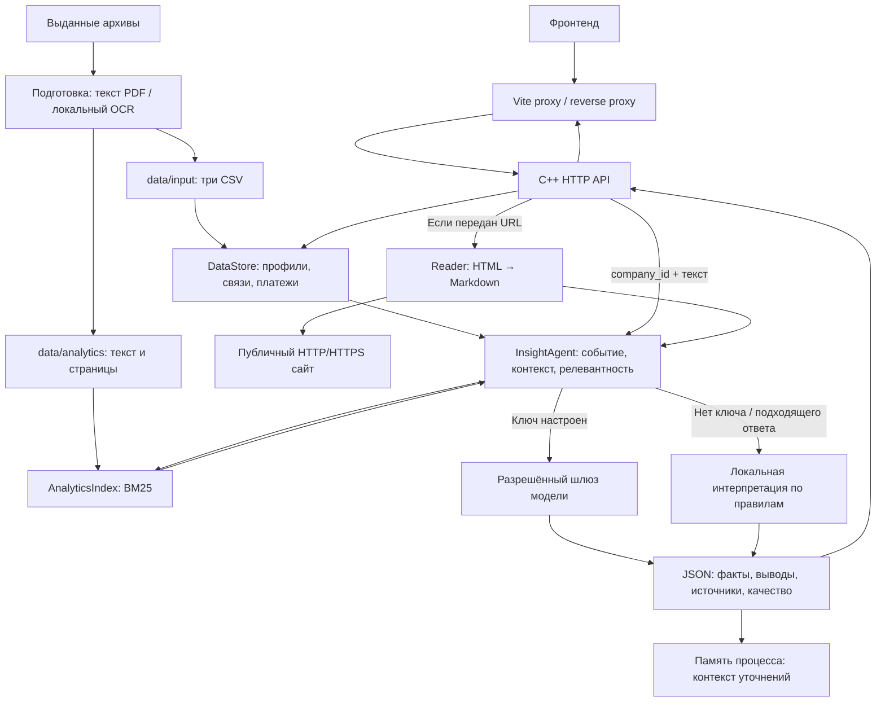

# Устройство приложения

Общая схема backend, зависимости и порядок подключения команд. Подробности: [запуск](RUNBOOK.md), [фронтенд](FRONTEND.md), [данные](DATA.md), [ИИ](AI.md), [HTTP-контракт](../openapi.yaml), [примеры](../example/README.md).

## 1. Общая схема

Приложение — один процесс на C++20 с HTTP API. При старте он загружает CSV, агрегирует платежи и строит поисковый индекс банковских текстов. База данных, отдельный поисковый сервер и очередь задач для текущего запуска не требуются. Фронтенд и его proxy запускаются отдельно.



Парсер реализован в проекте и формирует представление страницы, похожее на Jina Reader. Сервис `r.jina.ai` не вызывается. Backend не раздаёт интерфейс, исходные PDF или историю анализов.

## 2. Как проходит анализ новости

1. **Компания.** Клиент ищет точный UID либо точный ОКВЭД через `GET /api/v1/companies?q=...`. Профиль и сеть платежей доступны отдельными маршрутами.
2. **Новость.** `POST /api/v1/insights` получает `company_id` и `text` либо публичный `url`. Если задан URL, backend загружает страницу даже при наличии `text` в том же запросе.
3. **Парсинг.** Проверяется публичность адреса, загружается HTML, удаляются служебные блоки, формируются Markdown и метаданные. JavaScript не исполняется. Предварительный `/api/v1/parse` не кэшируется для следующего анализа URL.
4. **Контекст.** Берутся отрасль, регион, выручка, банковские признаки и агрегаты компании. Пропуски остаются неизвестными. Процентиль выручки относится к выборке и не является долей рынка.
5. **Поиск.** BM25 выбирает до четырёх фрагментов банковских материалов по новости и контексту компании. Каждый фрагмент содержит документ, страницу и способ извлечения текста.
6. **Выводы.** Категории события и релевантность рассчитываются по правилам. При настроенном ключе вызывается разрешённая модель; по умолчанию возможен второй вызов для самопроверки. Без ключа или при неудачной генерации работает `deterministic_fallback`.
7. **Ответ.** JSON разделяет факты новости, профиль, банковские материалы и интерпретацию. Результат сохраняется в памяти. Уточнение отправляется на `/api/v1/insights/{id}/questions` с ID текущего анализа; история предыдущих уточнений не накапливается.

| ID источника | Содержимое | Где найти |
| --- | --- | --- |
| `N1` | Входная новость: текст или загруженная страница | `sources[]`: заголовок, URL при наличии, фрагмент |
| `C1` | Контекст выбранной компании | `sources[]`, `company_context` |
| `A1`–`A4` | Найденные банковские фрагменты; их может быть меньше | `sources[]`, `bank_analytics`: документ, страница, текст |

`evidence_ids` связывает утверждения с `sources` внутри одного ответа. Найденный фрагмент сам по себе не подтверждает позицию банка: `interpretation.bank_view` может быть `null`. BM25 score — поисковое соответствие, `relevance.score` — оценка для ранжирования; они не выражают вероятность финансового эффекта.

Режим генерации проверяется по `generation.method` и `quality_check.llm_used`: HTTP 200 не доказывает, что использовалась модель. Уточнение без модели возвращает справочный ответ по сохранённым источникам без нового содержательного вывода.

## 3. Где что находится

| Путь | Ответственность |
| --- | --- |
| `src/main.cpp` | Инициализация, настройки процесса, загрузка данных |
| `src/http_server.cpp/.hpp` | HTTP, маршруты, входящая авторизация и лимиты |
| `src/reader.cpp/.hpp` | Загрузка публичных страниц, очистка HTML, Markdown |
| `src/data_store.cpp/.hpp` | CSV, профили, связи, платежные агрегаты |
| `src/analytics.cpp/.hpp` | Разделение текста на страницы/фрагменты, BM25 |
| `src/agent.cpp/.hpp` | Анализ, релевантность, источники и уточняющие вопросы |
| `src/llm_client.cpp/.hpp` | Разрешённые шлюзы/модели, запросы к модели |
| `src/json.hpp` | Чтение и запись JSON |
| `data/input/` | Три подготовленных CSV |
| `data/analytics/` | Банковские тексты `.md`/`.txt`, `manifest.json` с происхождением |
| `scripts/` | Запуск/остановка, чтение конфигурации, `prepare_data.py`, его зависимости |
| `tools/windows_ocr.cpp` | C++-утилита локального Windows OCR |
| `example/` | C++ клиент, входные JSON, сценарии запуска; ответы в `output/` |
| `docs/`, `openapi.yaml` | Руководства команды, примеры интеграции и HTTP-контракт |
| `tests/` | Проверки индекса и скриптов запуска |
| `AlphaBackend.sln`, `*.vcxproj` | Проекты Visual Studio; клиент имеет проект в `example/` |
| `CMakeLists.txt` | Сборка CMake |
| `Dockerfile`, `docker-compose.yml` | Linux-образ backend и запуск контейнера |
| `.env.example` | Шаблон локальной конфигурации |
| `start-server.cmd`, `stop-server.cmd` | Запуск и остановка через Windows PowerShell |

Результаты сборки появляются в `x64/Release/`, `build/` или `example/bin/`. Скрипты создают `work/` для состояния фоновых процессов и логов. Эти каталоги не являются входными данными. Пути в отчётах примеров и состоянии запуска сохраняются относительно корня проекта.

Исходные ZIP/PDF нужны для повторной подготовки. Работающий backend читает готовые CSV и текстовые материалы: он не распаковывает архивы и не выполняет OCR.

## 4. Что требуется

| Задача | Обязательные компоненты | Необязательные компоненты |
| --- | --- | --- |
| Запуск готового backend | Executable, runtime его сборки, три CSV; Windows PowerShell 5.1 для `.cmd`/`.ps1` | Банковские тексты для поиска и подтверждений; ключ только для модели |
| Запуск на Windows | Доступные DLL зависимостей; у поставленной сборки рядом лежат `libcurl.dll`, `z.dll`; соответствующий Microsoft Visual C++ Runtime | Visual Studio не нужна для запуска готовой сборки |
| Сборка Visual Studio | C++ workload, Windows SDK, выбранный toolset, vcpkg с `curl:x64-windows` | `VCPKG_ROOT` указывает на свою установку; поддержан соседний каталог `vcpkg` |
| Сборка CMake | CMake 3.21+, компилятор C++20, libcurl, системные потоки | Клиент примеров выключается через `-DALFA_BUILD_EXAMPLES=OFF`; OCR-цель только Windows |
| Повторная подготовка | Исходные архивы, Python и пакеты из `scripts/requirements.txt` | Для страниц без текстового слоя: Windows OCR или Tesseract `rus`+`eng` |
| Разработка интерфейса | Свой frontend-проект, его зависимости, backend и proxy | Node.js относится к фронтенду и не нужен C++ серверу |
| Анализ локального текста | Готовый backend и данные | Интернет не требуется в режиме без модели |
| Анализ URL / генерация моделью | Доступ к публичному сайту / разрешённому шлюзу | Для модели дополнительно нужен ключ в backend |

Launcher требует все три файла: `df_Uid_data_hack.csv`, `df_Uid_payment_hack.csv`, `df_Fid_Uid_link_hack.csv`. Отсутствие каталога аналитики не останавливает backend, но поиск и `A`-источники будут пустыми. Данные загружаются при старте: после обновления нужен перезапуск.

Python, OCR и компилятор не нужны для обычной работы с подготовленными данными. При подготовке сначала читается текст PDF; страницы без достаточного текстового слоя распознаются локально. Для Windows нужны `AlphaPdfOcr.exe` и русский язык OCR, для Linux — Tesseract с `rus` и `eng`. Происхождение текста и страницы фиксируются в `manifest.json`; спорные числа и таблицы сверяйте с PDF.

## 5. Настройки и порты

Локальный `.env` создаётся из `.env.example`. Ключ модели и входящий токен API имеют разное назначение.

| Параметр | Значение по умолчанию / назначение |
| --- | --- |
| `ALFA_HOST`, `ALFA_PORT` | `127.0.0.1`, `8080`: IPv4-адрес и порт обычного запуска |
| `ALFA_DATA_DIR` | `data/input`: каталог трёх CSV |
| `ALFA_ANALYTICS_DIR` | `data/analytics`: каталог подготовленных банковских текстов |
| `ALFA_API_TOKEN` | Пусто: необязательная защита входящего API |
| `ALFA_LLM_API_KEY` | Пусто: ключ исходящего вызова модели, только на backend |
| `ALFA_LLM_BASE_URL` | `https://changellenge.up.railway.app/v1`: разрешённый шлюз |
| `ALFA_LLM_MODEL` | `deepseek/deepseek-v4.1-flash`: модель из разрешённого списка |
| `ALFA_LLM_TIMEOUT_SECONDS` | `35`: тайм-аут одного вызова, допустимо 5–90 секунд |
| `ALFA_AGENT_SELF_CHECK` | `1`: самопроверка, возможен второй вызов модели |

Windows launcher: явные параметры запуска → `.env` → унаследованные `ALFA_*` → значения по умолчанию. `-NoLlm` отключает вызовы модели для процесса. Пути данных разрешаются относительно корня проекта. C++ executable сам `.env` не читает: при прямом запуске используются окружение процесса и текущая папка для относительных путей.

При прямом запуске C++ поддерживает `OPENAI_API_KEY` как запасной ключ. Launcher очищает его у дочернего процесса и использует отдельный `ALFA_LLM_API_KEY`.

При непустом `ALFA_API_TOKEN` маршруты `/api/v1/*` требуют `Authorization: Bearer ...` или `x-api-key`; `/health` открыт. В браузерной интеграции токен добавляет серверный proxy. Ключ модели не включается в frontend. `models.configured=true` показывает наличие ключа, но не подтверждает работоспособность шлюза или остаток бюджета. Адреса и модели перечислены в [AI](AI.md).

Обычный запуск использует порт `8080`. Примеры — отдельный `127.0.0.1:18080`, конфигурацию `example/service.env` и принудительно выключенную модель. При своём `-Port` передавайте тот же порт команде остановки. Два экземпляра не должны занимать один порт.

## 6. Порядок запуска

Все команды выполняются из корня проекта. Для полного локального сценария нужны готовые backend, C++ клиент и данные:

```powershell
.\example\start.cmd
# Остановить после работы:
.\example\stop.cmd
```

Сервис остаётся на `http://127.0.0.1:18080`. Ответы сохранены в `example/output/`, последний прогон указан в `example/output/latest.json`. Для прогона с автоматической остановкой используйте `.\example\run.cmd`. Внешний запрос парсера добавляется только с `-IncludeWebExample`.

Для обычного фонового backend без модели сначала создайте `.env`, если его ещё нет, затем запустите:

```powershell
if (!(Test-Path -LiteralPath .env)) { Copy-Item .env.example .env }
.\start-server.cmd -NoLlm -Background
Invoke-RestMethod http://127.0.0.1:8080/health
.\stop-server.cmd -Port 8080
```

Без `-Background` процесс работает в текущем окне и останавливается `Ctrl+C`. Для генерации моделью настройте локальный `ALFA_LLM_API_KEY`, разрешённый адрес и модель, затем запускайте без `-NoLlm`. Подробности — [RUNBOOK](RUNBOOK.md).

При отсутствии данных или обновлении архивов:

```powershell
python -m pip install -r scripts/requirements.txt
python scripts/prepare_data.py .
```

Только CSV: `python scripts/prepare_data.py . --data-only`. Только аналитика Windows: `python scripts/prepare_data.py . --analytics-only --ocr windows`. После обновления перезапустите backend. Схема и правила обработки находятся в [DATA](DATA.md).

## 7. Подключение команд

| Команда | Что нужно | Где работает и что согласует |
| --- | --- | --- |
| Фронтенд | Backend, его адрес, JSON-контракт, свой frontend-проект и proxy | [FRONTEND](FRONTEND.md), [OpenAPI](../openapi.yaml), `docs/examples/vite.config.ts`; компания, новость, состояния загрузки/ошибок, источники, уточнения |
| Данные | Архивы, схема CSV, тексты; Python/OCR только для подготовки | [DATA](DATA.md), `data/`, `scripts/prepare_data.py`; пропуски, трактовка признаков, обновление корпуса, страницы и происхождение |
| ИИ | Ключ разрешённого шлюза только на backend, фиксированные входы и источники | [AI](AI.md), `src/agent.cpp`, `src/llm_client.cpp`, `example/requests/`; промпты, `evidence_ids`, самопроверка, качество и расход вызовов |
| Backend | C++20, libcurl, данные и согласованный API | `src/`, проекты сборки, `scripts/`, [RUNBOOK](RUNBOOK.md); HTTP, парсер, агрегация, поиск и оркестрация |

Фронтенд обращается к относительным `/api/v1/...` и `/health`. В разработке нужен Vite proxy, при размещении — общий origin с reverse proxy: backend не реализует CORS и `OPTIONS`. Адрес proxy — `http://127.0.0.1:8080` либо `http://127.0.0.1:18080` для примеров. `ALFA_BACKEND_URL` относится к примеру Vite, backend её не читает.

Интерфейс и данные можно подключать без модели. В модельном режиме шлюзу передаются текст новости, выбранный контекст и найденные фрагменты; самостоятельно читать локальные CSV/PDF шлюз не может.

## 8. Docker и ограничения

Docker-образ включает Linux backend, runtime libcurl, TLS-сертификаты и данные. Фронтенд, Windows OCR, клиент примеров и Python-конвейер подготовки в него не входят. Данные готовятся до запуска.

```powershell
docker compose up --build -d
docker compose logs -f alpha-backend
docker compose down
```

В контейнере адрес `0.0.0.0:8080`; Compose публикует порт только на `127.0.0.1`, а `ALFA_PORT` выбирает внешний порт. `./data` подключается в `/app/data` только для чтения и перекрывает копию из образа. Окружение терминала может перекрывать `.env`. После замены данных нужен перезапуск; после изменения окружения — `docker compose up -d --force-recreate`.

- **Синхронность.** Ответ анализа приходит после загрузки, поиска и возможных вызовов модели. Нет очереди, SSE и потоковой выдачи. Для upstream proxy задайте тайм-аут не менее 240 секунд; повторный анализ может повторно вызвать модель.
- **Память.** Хранятся не более 500 анализов, вытеснение без гарантии порядка. При перезапуске ID теряются. Постоянного хранилища и маршрута истории нет.
- **HTTP.** JSON UTF-8, POST с `Content-Type: application/json` и обычной длиной тела. `Transfer-Encoding: chunked` не поддерживается. Лимиты: заголовки 64 КиБ, тело 2 МиБ, до 64 активных клиентов.
- **Поля запроса.** Максимумы в байтах UTF-8: `text` — 30 000, `title` — 1 000, `url` — 4 096, `question` — 2 000. Для кириллицы число символов меньше числа байт. Контекст модели дополнительно сокращается.
- **Источники и поиск.** Только публичные HTTP(S)-адреса; страницы с защитой или JavaScript могут не извлечься. Поиск компаний — точный UID или ОКВЭД. По имени PDF из `sources` нет маршрута скачивания.
- **Размещение.** Встроенный токен относится ко всему экземпляру. Пользовательские учётные записи, TLS, постоянные сессии, отдельные лимиты бюджета и аудит доступа требуют внешних компонентов.

Начальная точка документации — [README](../README.md); диагностика запуска и ответов — [RUNBOOK](RUNBOOK.md).
